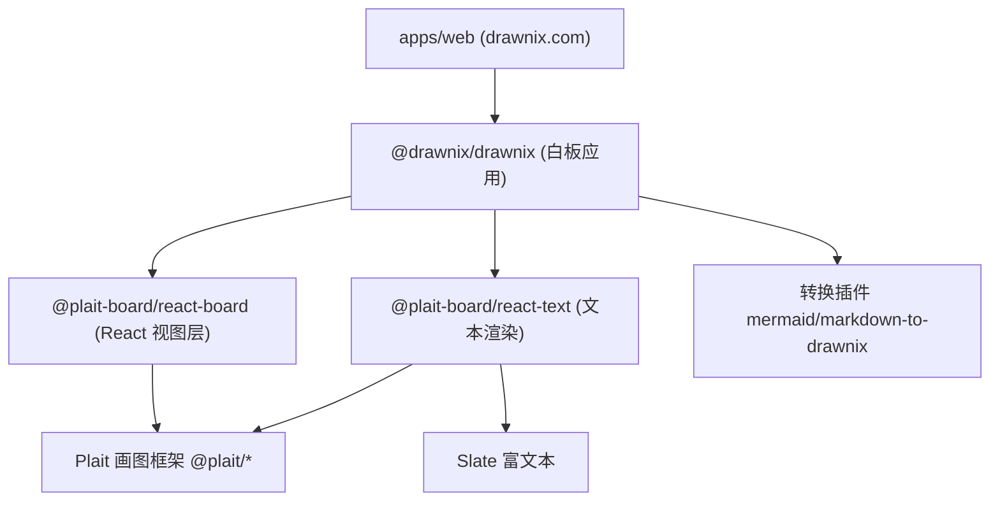

# Drawnix 项目结构分析报告

## 一、项目概述

**Drawnix** 是一款开源、免费的一体化在线白板工具（SaaS），支持思维导图、流程图、自由手绘等能力。项目当前版本为 `0.4.0`，采用 **MIT 协议**开源。

- **底层画图引擎**：基于 [Plait](https://github.com/worktile/plait) 开源画图框架（`@plait/*` 系列，版本 `0.93.1`）
- **架构特点**：插件化架构，支持多 UI 框架（当前为 React），富文本基于 Slate
- **线上应用**：[drawnix.com](https://drawnix.com)

---

## 二、技术栈

| 分类 | 技术选型 |
|------|---------|
| 前端框架 | React 19.2.0 |
| 语言 | TypeScript 5.4 |
| 构建工具 | Vite 6 + SWC |
| Monorepo 管理 | Nx 19.3.0 |
| 画图引擎 | Plait（core / draw / mind / layouts / common / text-plugins）|
| 富文本 | Slate 0.116（slate-react / slate-history / slate-dom）|
| 样式 | SCSS |
| 弹出层 | @floating-ui/react |
| 本地存储 | localforage（IndexedDB / LocalStorage）|
| 测试 | Jest（单元）+ Playwright（E2E）+ Vitest |
| 代码规范 | ESLint + Prettier |
| 部署 | Docker + Cloudflare Pages |

**特色依赖**：
- `@plait-board/mermaid-to-drawnix`：Mermaid 语法转流程图
- `@plait-board/markdown-to-drawnix`：Markdown 转思维导图
- `laser-pen`：激光笔演示功能
- `roughjs`：手绘风格图形渲染

---

## 三、Monorepo 结构

项目采用 Nx 管理的 Monorepo，分为 **apps（应用）** 和 **packages（库）** 两层：

```
drawnix/
├── apps/                       # 应用层
│   ├── web/                    # drawnix.com 主站应用
│   └── web-e2e/                # Playwright 端到端测试
├── packages/                   # 库层（可独立发布 npm 包）
│   ├── drawnix/                # @drawnix/drawnix          白板应用主体
│   ├── react-board/            # @plait-board/react-board  白板 React 视图层
│   └── react-text/             # @plait-board/react-text   文本渲染模块
├── scripts/                    # 发布 / 版本管理脚本
├── nx.json                     # Nx 工作区配置
├── Dockerfile                  # 容器化部署
└── package.json                # 根依赖与脚本
```

### 分层架构图



---

## 四、核心 Package 详解

### 1. `@drawnix/drawnix`（白板应用主体）

面向业务的顶层封装，导出核心组件 `Drawnix`。源码结构：

| 目录/文件 | 职责 |
|-----------|------|
| `drawnix.tsx` | **核心入口组件**，组装插件、工具栏、上下文 |
| `components/` | UI 组件（工具栏、颜色/形状选择器、菜单、弹窗、教程、TTD 对话框等）|
| `plugins/` | 自定义插件（freehand 自由手绘、hotkey 快捷键、pencil 铅笔、text-link、image、mind-extend 等）|
| `hooks/` | React Hooks（`use-drawnix` 状态管理）|
| `i18n/` | 国际化 |
| `transforms/` | 数据变换 |
| `utils/` | 工具函数（如激光笔）|
| `data/`、`constants/` | 数据与常量定义 |

**`Drawnix` 组件设计要点**：

- 通过 `PlaitPlugin[]` 数组装配插件链：`withDraw` → `withGroup` → `withMind` → `withMindExtend` → `withCommonPlugin` → 快捷键 → freehand → pencil → text-link
- 使用 `DrawnixContext` 管理应用状态（`appState`），包括指针类型、移动端检测、铅笔模式、自由手绘预设等
- 通过 `MobileDetect` 实现移动端适配
- 暴露丰富的回调：`onChange`、`onSelectionChange`、`onViewportChange`、`onThemeChange` 等

### 2. `@plait-board/react-board`（React 视图层）

将 Plait 引擎适配到 React，提供 `Board`、`Wrapper` 组件。

| 文件 | 职责 |
|------|------|
| `board.tsx` | 画板组件 |
| `wrapper.tsx` | 数据/事件包装层，负责 value、viewport、theme 的双向绑定 |
| `plugins/` | `with-react`（React 渲染桥接）、`with-pinch-zoom-plugin`（移动端双指缩放）、`board` |
| `hooks/` | 视图相关 Hooks |

### 3. `@plait-board/react-text`（文本渲染模块）

基于 Slate 的富文本渲染层，独立成包以便复用。

| 文件 | 职责 |
|------|------|
| `text.tsx` | 文本编辑/渲染组件 |
| `custom-types.ts` | Slate 自定义类型定义 |
| `plugins/` | 文本相关插件 |

---

## 五、应用层（apps/web）

`apps/web` 是 drawnix.com 的最小化实现，核心逻辑非常简洁（`app.tsx` 仅 85 行）：

- 引入 `Drawnix` 组件渲染白板
- 使用 **localforage** 实现自动保存（IndexedDB 优先，降级 LocalStorage），存储键为 `main_board_content`
- 首次进入或空内容时展示 **Tutorial（新手引导）**
- 内置调试日志能力（`addDebugLog`）

E2E 测试位于 `apps/web-e2e`，基于 Playwright。

---

## 六、工程化与构建

### 常用脚本（根 package.json）

| 命令 | 说明 |
|------|------|
| `npm run start` | 启动 web 开发服务器（`nx serve web`）|
| `npm run build` | 构建所有项目 |
| `npm run build:web` | 仅构建 web 应用 |
| `npm run lint` | 全量 ESLint 检查并修复 |
| `npm run test` | 运行所有测试 |
| `npm run release` | 版本发布（`scripts/release-version.js`）|
| `npm run pub` | 构建并发布 npm 包 |

### Nx 配置要点（nx.json）

- **插件**：集成 Vite（build/test/serve/preview）、ESLint（lint）、Playwright（e2e）、Jest（test）
- **代码生成器**：React 应用/库默认使用 SCSS、ESLint、Vite、Jest
- **发布配置**：维护 workspace 级 `CHANGELOG.md`，不自动 git commit/tag（由脚本控制）

### 部署

- **Docker**：提供 `Dockerfile`，镜像 `pubuzhixing/drawnix:latest`
- **Cloudflare Pages**：见 `CFPAGE-DEPLOY.md`，含 `_headers`、`_redirects` 配置
- **CI/CD**：`.github/workflows/` 下有 `ci.yml`（持续集成）与 `publish.yml`（发布）

---

## 七、核心功能特性

- 💯 免费 + 开源（MIT）
- ⚒️ 思维导图、流程图绘制
- 🖌 自由画笔 / 铅笔模式 / 激光笔
- 😀 插入图片
- 🚀 插件化架构（可扩展）
- 🖼️ 导出 PNG、JSON（`.drawnix` 格式）
- 💾 浏览器缓存自动保存
- ⚡ 撤销、重做、复制、粘贴等编辑能力
- 🌌 无限画布（缩放、滚动）
- 🎨 主题模式切换
- 📱 移动端适配
- 📈 Mermaid 语法转流程图
- ✨ Markdown 转思维导图

---

## 八、总体评价

**架构优点：**

1. **清晰的分层设计**：应用层（web）→ 业务封装层（drawnix）→ 视图适配层（react-board / react-text）→ 底层引擎（Plait），职责分明、复用性强。
2. **插件化机制**：通过 Plait 插件体系灵活组合能力，便于扩展和维护。
3. **完备的工程化**：Nx Monorepo + Vite + ESLint + Prettier + Jest + Playwright + CI/CD，工具链成熟。
4. **独立发布能力**：三个 package 均可作为独立 npm 包发布（`private: false`），具备良好的生态输出能力。

**可关注点：**

- 根 `package.json` 版本（`0.0.2`）与各 package 版本（`0.4.0`）不一致，属于工作区管理与发布版本的分离，需留意发布脚本的一致性处理。
- 依赖 Plait 框架版本较统一（`0.93.1`），升级时需注意协同。

总体而言，这是一个**结构规范、分层清晰、工程化程度高**的现代前端开源白板项目，适合二次开发与能力扩展。
